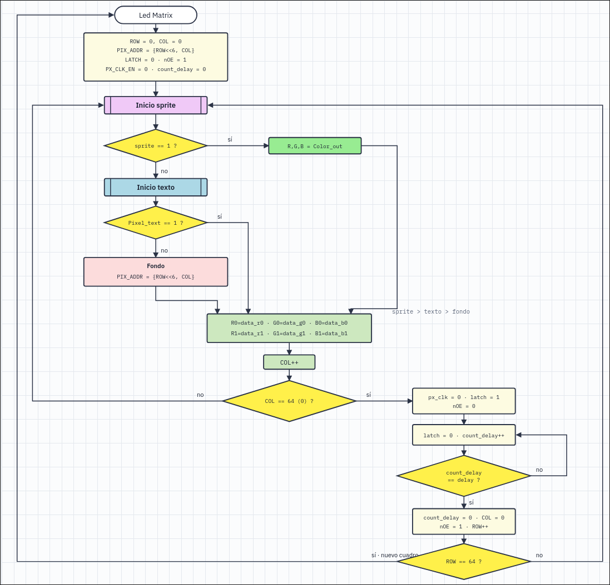
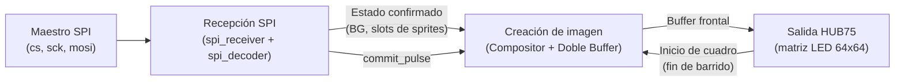
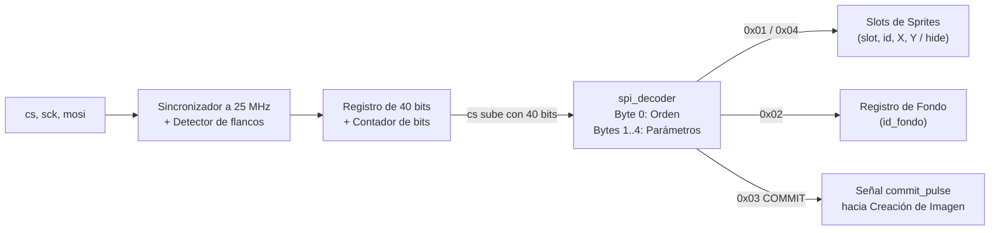
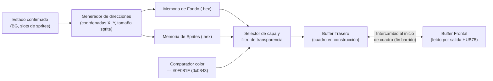

#  Driver de Panel LED (Texto, Sprites y Fondo)

Documenta e implementa el controlador lógico encargado del dibujado  y la generación de señales de hardware para el LED. La arquitectura utiliza diagramas de flujo  procesa la pantalla píxel a píxel, evaluando múltiples capas visuales concurrentes.

## Jerarquía de Renderizado

El núcleo del controlador determina el color final de cada coordenada (`col`, `row`) aplicando un orden estricto de prioridad de tres niveles (sprite > texto > fondo):

* **Nivel 1 (Sprite):** El módulo comprueba si en la celda actual hay asignado un sprite y si el píxel específico no es de un color transparente. Si `sprite == 1`, se emite su color `Color_out (R, G, B)` y se descartan las capas inferiores.
* **Nivel 2 (Texto):** Si la capa del sprite está vacía o es transparente, se consulta la matriz de caracteres. Si el píxel forma parte del trazo de una letra (`Pixel_text == 1`), se utiliza el color de fuente asignado.
* **Nivel 3 (Fondo):** En ausencia de sprites o texto, el sistema recurre a la memoria de imagen general, extrayendo el píxel base usando la dirección unificada `PIX_ADDR = {ROW<<6, COL}`.

 
###  Vista general del sistema
 

 
###  Recepción SPI (spi_receiver + spi_decoder)
 

 
###  Creación de imagen (Compositor + Doble Buffer)
 

 
