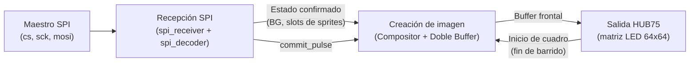

# Driver de Panel LED (Texto, Sprites y Fondo)

Se Documento e implemento el controlador lógico encargado del dibujado y la generación de señales de hardware para el LED. La arquitectura utiliza diagramas de flujo procesa la pantalla píxel a píxel, evaluando múltiples capas visuales concurrentes.




## Jerarquía de Renderizado
El  controlador determina el color final de cada coordenada (
`col`, `row`) aplicando un orden estricto de prioridad de tres niveles (sprite > texto > fondo):

- **Nivel 1 (Sprite):** El módulo comprueba si en la celda actual hay asignado un sprite y si el píxel específico no es de un color transparente. Si `sprite == 1`, se emite su color `Color_out (R, G, B)` y se descartan las capas inferiores.
- **Nivel 2 (Texto):** Si la capa del sprite está vacía o es transparente, se consulta la matriz de caracteres. Si el píxel forma parte del trazo de una letra (`Pixel_text == 1`), se utiliza el color de fuente asignado.
- **Nivel 3 (Fondo):** En ausencia de sprites o texto, el sistema recurre a la memoria de imagen general, extrayendo el píxel base usando la dirección unificada `PIX_ADDR = {ROW<<6, COL}`.


## Generador de  Sprites

Basado en arquitecturas tradicionales de rasterización por hardware, la pantalla de 64x64 píxeles se segmenta conceptualmente en una cuadrícula de celdas de 8x8 píxeles.

- **Indexación de RAM:** Los bits superiores de las coordenadas de dibujo (`Row[5:3]` y `Col[5:3]`) se concatenan para calcular `ram_addr`, la dirección en la memoria RAM que indica qué `Sprite_ID` ocupa esa celda.
- **Extracción en ROM:** Si el identificador no es 0 (celda vacía), los bits inferiores (`Row[2:0]`) se combinan con el identificador para leer la fila de píxeles correcta desde la ROM del sprite (`Sprite_row`).
- **Manejo de Transparencia:** Cada píxel almacena datos RGB en 3 bits. El valor `000` se designa como canal alfa puro (transparente), forzando a la lógica a ignorar el sprite e imprimir el contenido de la capa inferior.
![[Generador_sprite.png]]

#### ** Recepción SPI (spi_receiver + spi_decoder) **
 
```mermaid
flowchart LR
    IN["cs, sck, mosi"] --> SYNC["Sincronizador a 25 MHz<br/>+ Detector de flancos"]
    SYNC --> SHIFT["Registro de 40 bits<br/>+ Contador de bits"]
    SHIFT -- "cs sube con 40 bits" --> DEC["spi_decoder<br/>Byte 0: Orden<br/>Bytes 1..4: Parámetros"]
    DEC -- "0x01 / 0x04" --> SPR_REG["Slots de Sprites<br/>(slot, id, X, Y / hide)"]
    DEC -- "0x02" --> BG_REG["Registro de Fondo<br/>(id_fondo)"]
    DEC -- "0x03 COMMIT" --> TRIG["Señal commit_pulse<br/>hacia Creación de Imagen"]


## Generador de Texto


Para procesar las fuentes y cadenas de caracteres, se reutiliza la división de celdas de 8x8 con memorias de propósito específico.

- **Decodificación de Caracteres:** La dirección base `Ram_text` apunta a una memoria que devuelve el código ASCII/alfanumérico del carácter (ej. 65 para 'A') contenido en esa cuadrícula.
- **Mapeo de Fuentes:** Se lee un vector binario desde la ROM de fuentes usando la fila del píxel (`font_rom = ROM[ROM_addr]`). Se verifica si el bit posicional correspondiente a `Col[2:0]` está en estado alto (activo) o bajo (vacío)

#### Creación de imagen (Compositor + Doble Buffer)
 
```mermaid
flowchart LR
    CMD_IN["Estado confirmado<br/>(BG, slots de sprites)"] --> ADDR_GEN["Generador de direcciones<br/>(coordenadas X, Y, tamaño sprite)"]
    ADDR_GEN --> MEM_BG["Memoria de Fondo (.hex)"]
    ADDR_GEN --> MEM_SPR["Memoria de Sprites (.hex)"]
    MEM_BG --> MUX["Selector de capa y<br/>filtro de transparencia"]
    MEM_SPR --> MUX
    TRANS["Comparador color<br/>== #0F081F (0x0843)"] --> MUX
    MUX --> BACK_BUF["Buffer Trasero<br/>(cuadro en construcción)"]
    BACK_BUF <-- "Intercambio al inicio<br/>de cuadro (fin barrido)" --> FRONT_BUF["Buffer Frontal<br/>(leído por salida HUB75)"]
```
 

