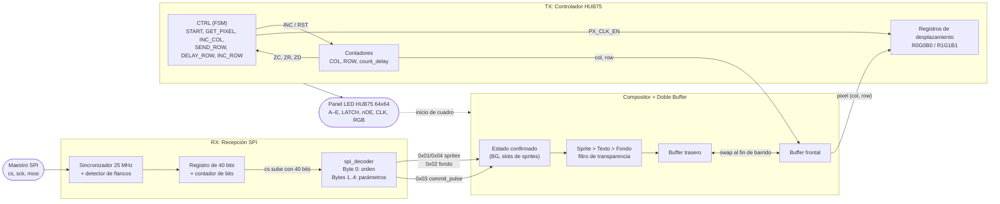

### Diagrama de bloques del Driver (RX + Compositor + TX)

*Figura X. Arquitectura del driver: el bloque RX decodifica los comandos SPI, el compositor arma el cuadro en el buffer trasero y el bloque TX lo envía al panel desde el buffer frontal.*
