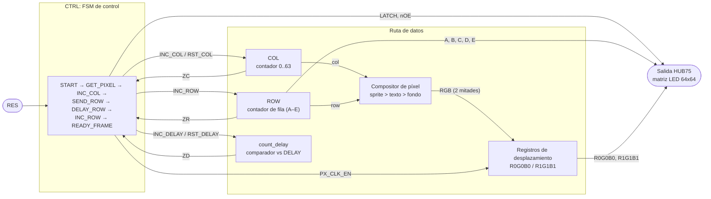

### Diagrama de bloques del Controlador HUB75 (Control + Ruta de datos)

*Figura X. Diagrama de bloques del controlador: la unidad de control (FSM) genera las señales de incremento, reloj y enganche, y recibe de vuelta las banderas ZC, ZR y ZD desde los contadores.*
