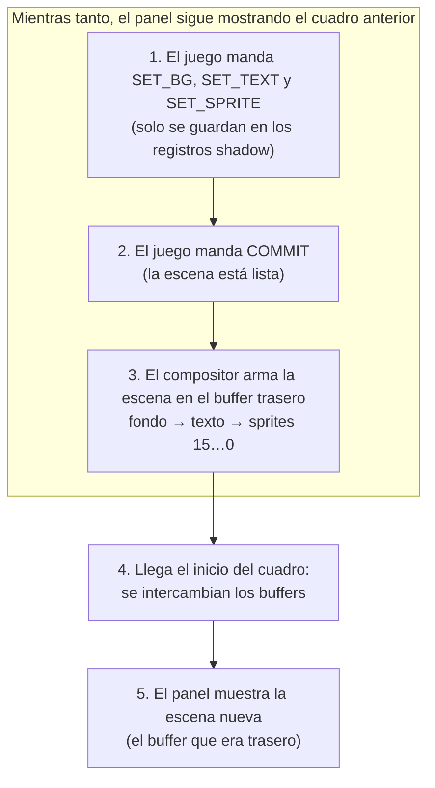
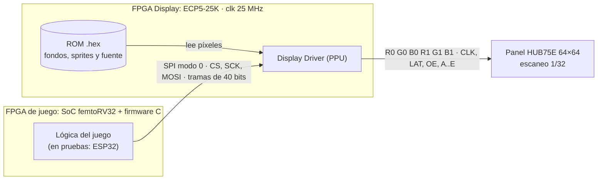
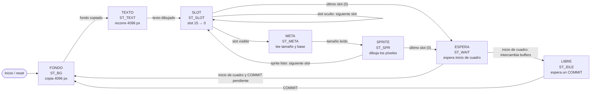
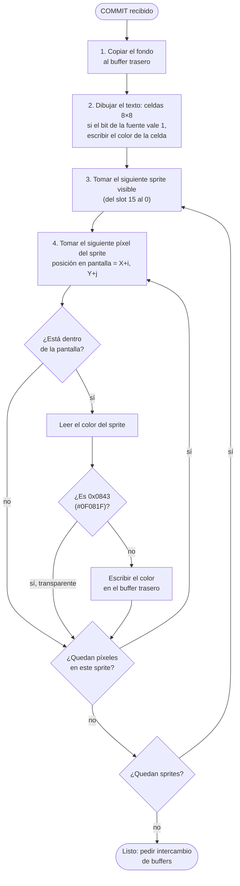
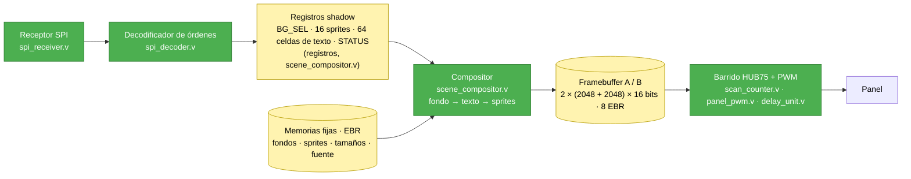
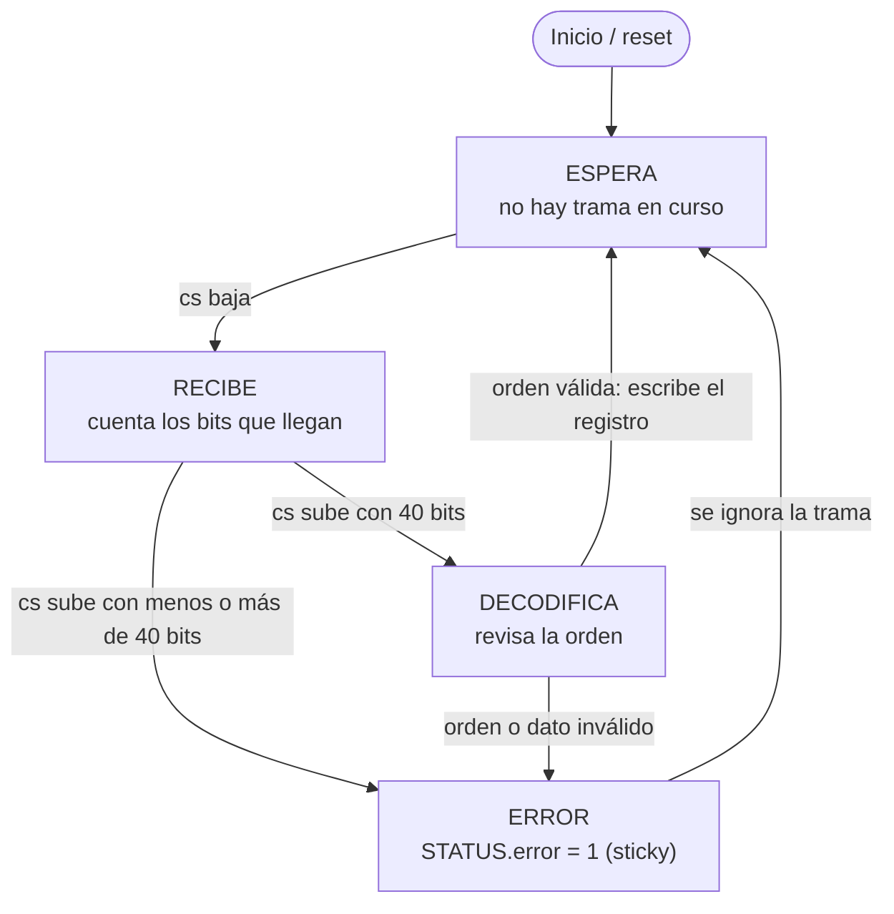
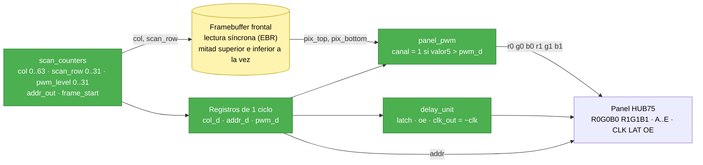

# Diagramas actualizados (entrega 03)

Cada diagrama dice a qué módulo/estado/señal del código corresponde y qué test
lo verifica. Los colores siguen los del `04 - Diagramas`: verde = implementado y
probado, amarillo = registros/memorias, azul = diagrama de estados.

---

## 1. Secuencia de un cuadro  (reemplaza «Secuencia de un cuadro»)

Cambio: aparece `SET_TEXT`, y el compositor arma fondo → texto → sprites.

Código: `spi_decoder.v` (órdenes 01–06), `scene_compositor.v` (shadow → `snapshot_scene`
→ render), swap en estado `ST_WAIT` con `frame_start`.
Tests: `pending_commit_TB.v`, `spec_rules_TB.v`.

---

## 2. Contexto del sistema  (cambio menor)

Cambio: la ROM incluye la fuente de texto.

---

## 3. Máquina de estados del compositor  (reemplaza «FSM del compositor»)

Cambios: (a) el arranque va a FONDO (renderiza el fondo 0 antes de `INIT_DONE`);
(b) aparece TEXTO; (c) SPRITES se descompone en SLOT, META y SPR;
(d) un COMMIT que llegó durante el render (pendiente) reinicia el render directamente
desde ESPERA, sin pasar por LIBRE.

Código: `localparam ST_*` y `case (state)` en `scene_compositor.v`.
Tests: `framebuffer_TB.v` (FONDO), `pending_commit_TB.v` (flecha ESPERA→FONDO),
`spec_rules_TB.v` (TEXTO/SLOT/META/SPR).

---

## 4. Datapath del compositor  (reemplaza «Datapath del compositor»)

Cambio: se agrega el paso 2 (texto) entre fondo y sprites.

Código: etapa 1 del pipeline en `scene_compositor.v` (`always @*` del puerto de
escritura: `bg_v`, `txt_v`, `spr_v`; recorte `spr_inside`; transparencia
`spr_rd != TRANSPARENT`). Las ROM tienen 1 ciclo de latencia, por eso el
dato se escribe un ciclo después de presentar la dirección.
Test: `spec_rules_TB.v` + `tools/ref_model.py` (4096 píxeles).

---

## 5. Bloques internos  (reemplaza «Bloques internos»)

Cambios: registros de texto, fuente en las memorias fijas, y todo pasa a verde
(ya está implementado y simulado). Se indica la memoria real de cada bloque.

Presupuesto de memoria medido en la síntesis (ECP5-25K): **29 de 56 EBR**
(fondos 13, sprites 7, fuente 1, framebuffers 8; la tabla de tamaños de sprites
queda en LUTs). Lógica: **31 % de las LUTs**.

---

## 6. Receptor SPI  (cambio menor)

Cambio: el error también ocurre con **más** de 40 bits (`overflow` en `spi_receiver.v`)
y cuando los bytes no usados de una orden no son 0 (`spi_decoder.v`).

Tests: `spi_receiver_TB.v`, `spi_invalid_TB.v` (15 casos).

---

## 7. Barrido HUB75  (reemplaza «Flujo de renderizado» y la FSM de CONTROL)

El código **no** tiene FSM de control ni decide capa por píxel: hay tres contadores
libres y la lectura del framebuffer ya compuesto. La capa (sprite > texto > fondo)
se decide al componer (diagrama 4), no durante el barrido.

Una línea (64 ciclos de 25 MHz), según `delay_unit.v` y `scan_counter.v`:

| ciclo (`col_d`) | pixel desplazado | `latch` | `oe` | `addr` |
|---|---|---|---|---|
| 0 | columna 0 | 0 | 1 (apagado) | cambia a la fila ya latcheada |
| 1 … 62 | columnas 1 … 62 | 0 | 0 (encendido) | estable |
| 63 | columna 63 | 1 | 1 (apagado) | estable |

Cuentas (reemplazan la tabla de refresco de la sección 8 del `03`):
64 ciclos por línea × 32 líneas × 32 niveles PWM = **65 536 ciclos = 2,62 ms ≈ 381 Hz**.
El brillo máximo es 31/32 y la oe queda encendida 62 de cada 64 ciclos.
Tests: `hw_check_TB.v` (columnas en los pines), `spec_rules_TB.v`.

---

## 8. Cambios de texto en `03 - Especificación`

| Sección | Cambio |
|---|---|
| 5 (órdenes) | agregar `0x05 SET_TEXT` (celda, carácter, color RGB565) y `0x06 HIDE_TEXT` (celda) |
| 4 (puertos) | `spi_miso` no está implementado: marcar «reservado» o quitar |
| 6 (STATUS) | bit 0 = `init_done`, bit 1 = `error` son señales internas, no pines |
| 8 (refresco) | 64 ciclos por línea, 2 de apagado, 381 Hz (ver diagrama 7) |
| nueva | presupuesto de memoria: 29/56 EBR, 31 % LUTs |
| 7.4 | `oe` en bajo durante 62 de 64 ciclos (el `01` dice «ancho − 3») |
